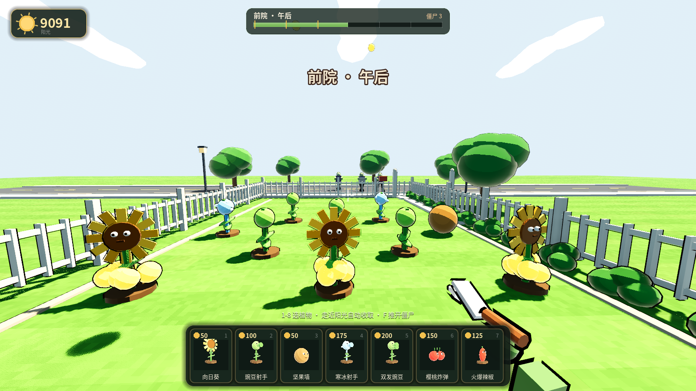
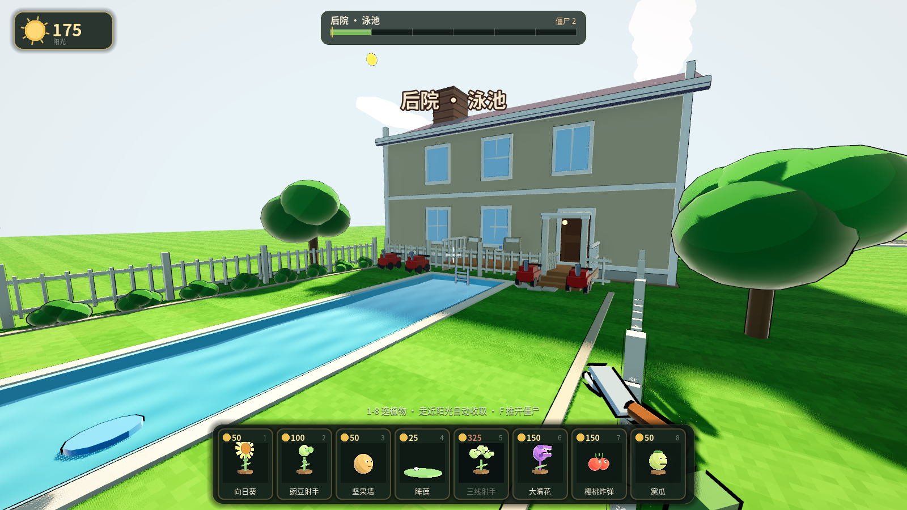
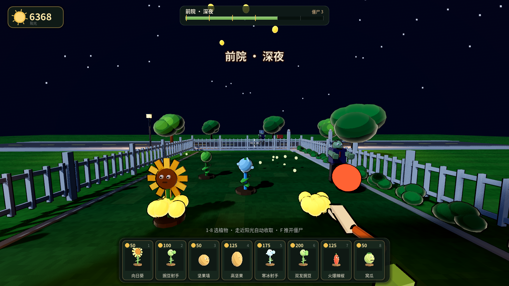
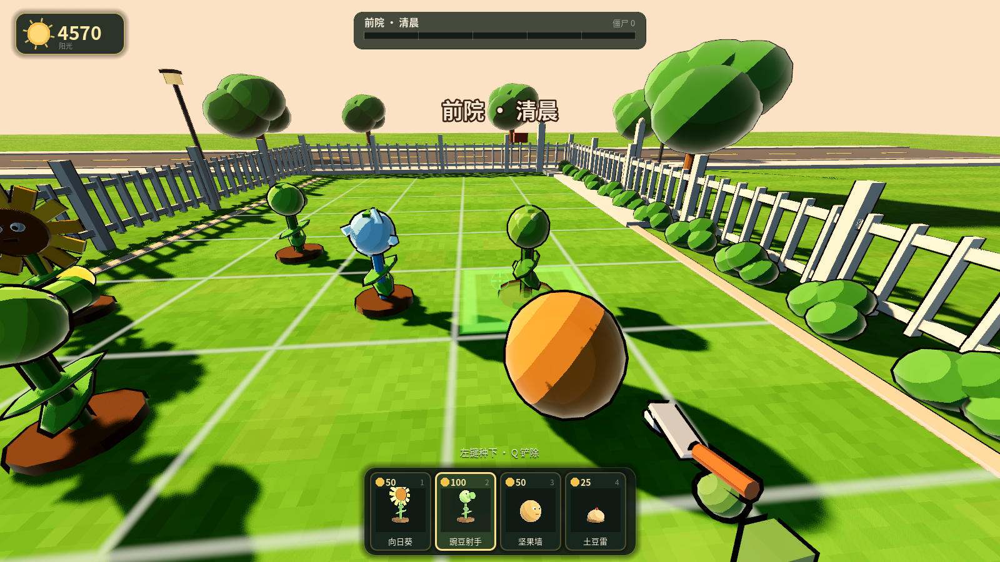
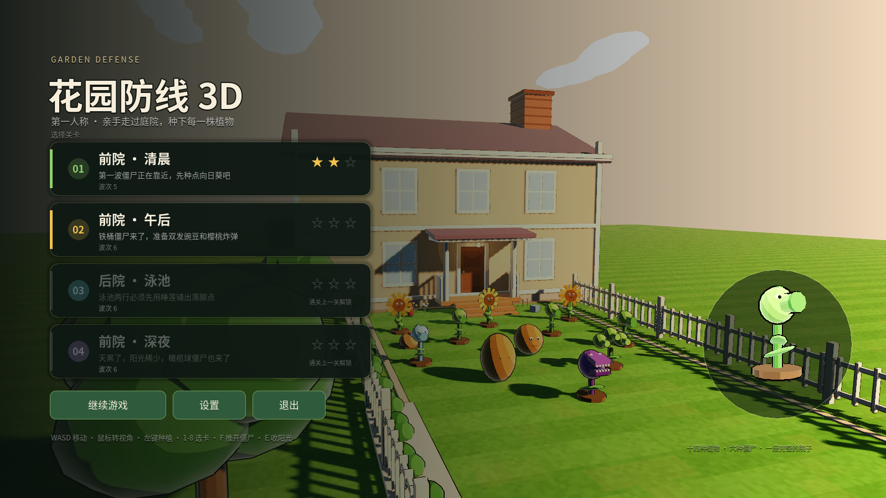
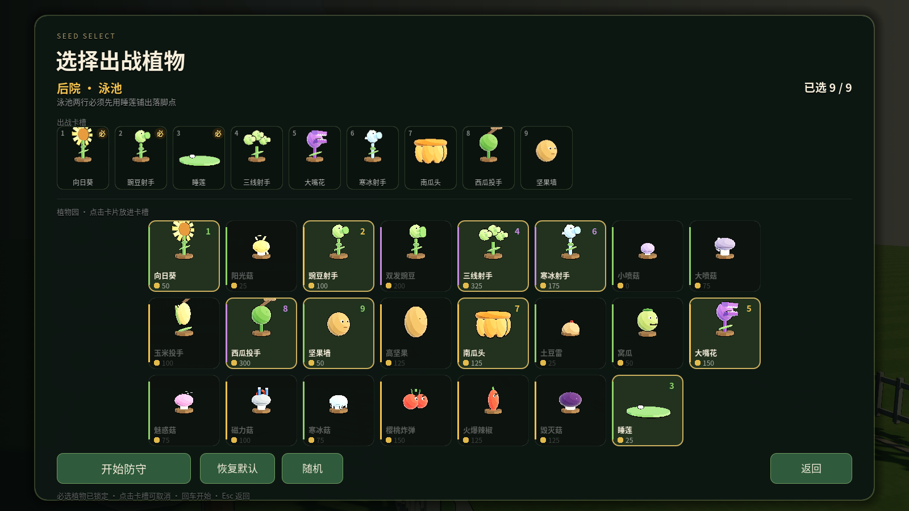

# PVZ3D — First-Person 3D Plants vs. Zombies

[](https://godotengine.org/)
[](https://threejs.org/)
[]()

A from-scratch, **first-person 3D remake of the original *Plants vs. Zombies***. You are on the lawn yourself: walk the yard, look around, and plant defenses right where you stand the reticle. No original game assets, no downloaded models or textures — every visual and sound is generated at runtime.

> Non-commercial fan project. All art and audio are original/procedural; no copyrighted *PvZ* material is used.

---

## Two builds, same game

This repository ships the game in two independent implementations:

| | **Godot build** (`godot/`) — flagship | **Browser build** (`src/` → `dist/`) — original |
| --- | --- | --- |
| Engine | Godot 4.7 | Three.js (r186) + TypeScript + Vite |
| Maturity | Feature-complete, actively developed | Original lighter prototype |
| Content | 23 plants · 11 zombie types · 4 levels · endless · shop · almanac | 3 levels, same first-person loop |
| Run it | Godot editor (F5) or the Windows `.exe` | Double-click `dist/pvz3d.html` |
| Art | Cel-shaded + outline, all code-generated | Procedural Canvas-2D textures + WebAudio |

The Godot build is the one to play and the one that gets new features. The browser build is a pure-web, single-file demo you can open with no install.

---

## Features (Godot build)

- **First-person lawn defense.** Walk the yard (`WASD`), look with the mouse, and plant into the grid at your crosshair. Sun still drops from the sky and must be collected by walking over to it.
- **23 plants** — sunflowers, peas (single / double / three-line / ice), lobbers (corn / watermelon), defenses (wall-nut / tall-nut / pumpkin), control & burst (potato mine / squash / chomper / cherry bomb / jalapeño / doom-shroom /Hypno-shroom / Magnet-shroom / Ice-shroom), mushrooms (puff / sun / fume), and lily pads for water rows.
- **11 zombie types** (12 models with the backup dancer) — basic, cone, bucket, flag, newspaper, football, **pole-vaulter**, **screen-door**, **balloon**, **dancing king**, and the **gargantuar**. Armor is a separate layer (magnet-shroom strips it).
- **4 campaign levels** on one continuous map: front-yard morning (tutorial) → front-yard afternoon → backyard pool (water rows need lily pads) → front-yard midnight (sparse sun, dancing king + gargantuar finale). Stars are awarded by performance.
- **Endless mode** with a scaling wave budget (budget grows, intervals shrink) and a best-wave record.
- **Coin economy + Crazy Dave's shop.** Zombies drop coins on death; a persistent wallet buys 4 permanent upgrades (starting sun, spare lawnmowers, shovel refund, coin multiplier) that apply to every run.
- **Almanac** of all 23 plants + 11 zombies, with live 3D previews, unlocked as you encounter them.
- **A house you can actually enter.** Two floors, real hinged doors (ray-picked, with collision that opens/closes), and a climbable chimney that takes you onto the roof ridge.
- **Toon rendering** — cel-shading + normal-extrusion outline, with dedicated shaders for grass, water, planting grid, and highlight.
- **Zero external assets.** Trees, fences, the house, plants, and zombies are all low-poly geometry assembled at runtime. Sound effects are synthesized WAVs generated by a Python script; background music is an external MP3.
- **Deterministic, verifiable simulation.** All gameplay lives in `Match.update(dt)`; visuals only read state. A headless `--sim` mode fast-forwards a full match and prints the result, backed by built-in `--test` suites (plants / zombies / water / coins / store / flow / art).

---

## Screenshots

<!--
  NOTE: image files under godot/screenshots/ are git-ignored in this repo, so the
  links below will be broken on GitHub unless you (a) commit the screenshots,
  (b) host them elsewhere and point these URLs there, or (c) drop them in.
  They render fine locally when the folder is present.
-->
| | |
| --- | --- |
|  |  |
| Front yard · afternoon | Backyard pool |
|  |  |
| Midnight level | Planting preview |
|  |  |
| 3D tombstone menu | Seed chooser |

---

## How to run

### Option A — Godot (recommended, full game)

1. Install [Godot 4.7](https://godotengine.org/).
2. Open the `godot/` folder as a project and press **F5**. First launch imports fonts/audio (~10 s).
3. Or grab the prebuilt Windows executable from the Releases / `build/` (single-file, ~124 MB, PCK embedded — double-click to play, no Godot install needed).

The renderer is Forward+ / D3D12 with shadows, SSAO, Glow, and ACES tone mapping enabled.

### Option B — Browser (instant, no install)

- **Double-click `dist/pvz3d.html`.** It is a self-contained single file (JS + CSS inlined) that runs straight from `file://` in any modern browser — no server, no Node.
- For development: `npm install` then `npm run dev` (serves at `http://127.0.0.1:5173`).

> The other HTML files (`index.html`, `dist/index.html`) are ES-module builds that need an HTTP server; only `dist/pvz3d.html` works on a plain double-click.

---

## Controls (Godot build)

| Key | Action |
| --- | --- |
| `WASD` / Arrows | Move |
| `Shift` | Sprint (stamina bar) |
| `Space` | Jump |
| Mouse | Look |
| `1`–`9` | Select seed card |
| Left click | Plant at the reticle |
| `Q` | Shovel the plant under the reticle |
| `E` | Context: open/close a door, climb a chimney, or collect sun in front of you |
| `F` / Right click | Shove a zombie with the shovel (cooldown) |
| `Esc` | Pause / settings |

The browser build uses a similar scheme (`1`–`7` to pick cards, `F`/left-click to plant, `Q` to shovel, `E` to collect sun, `Space` to jump/skip).

---

## Project structure

```
PVZ3D/
  godot/                 # Godot 4.7 build — the complete, maintained game
    project.godot
    scenes/main.tscn
    scripts/             # app, data, art, world, player, match, hud, ui/*, units/*
    shaders/             # toon / grass / water / grid / highlight / vignette
    fonts/ audio/        # Noto Sans SC; synthesized SFX (no copyrighted audio)
  src/                   # Three.js browser build (TypeScript)
  dist/                  # build output (dist/pvz3d.html = standalone single file)
  tools/                 # standalone build script, headless screenshot tool
  tests/                 # 27 unit tests (collision / layout / levels / fx)
  README.md              # Chinese documentation (this file's source of truth)
```

---

## Development & tests

- **Godot build:** gameplay logic is deterministic and headless-testable. Example:
  ```bash
  Godot_v4.7.2-stable_win64_console.exe --headless --path godot -- \
    --sim=230 --level=front-1 \
    --plants="0,0,sunflower;1,0,peashooter;2,0,wallnut"
  # [sim] { "state": "won", ... } kills=15 mowers_used=0
  ```
  Built-in suites: `--test=plants|zombies|water|coins|store|flow|art`.
- **Browser build:** `npm test` runs 27 `node --test` cases (all passing). `npm run typecheck` is clean.

---

## Known limitations / trade-offs

- The browser build is a frozen prototype (3 levels) and does not receive the Godot build's newer content (endless mode, new zombies/plants, music, coins).
- No save-mid-level; progress is recorded only at level completion.
- One save slot (stars / best wave / loadout / settings).
- Balloon zombies can be shot down by normal peas (no height check); giant has no imp.
- Water is vertex ripple + Fresnel approximation (no real reflection/refraction).
- Fixed 1600×900 logical resolution (letterboxed on ultrawide).

---

## License & disclaimer

This is an unofficial, non-commercial fan remake created for learning and fun. *Plants vs. Zombies* and related names are property of their respective owners; this project uses no original game assets. Code in this repository is released under the license stated in `LICENSE` (add one if you intend to publish).
