# 花园防线 3D · Godot 版

把原来那个 Three.js 的第一人称《植物大战僵尸》页游，重做成一个完整的 Godot 4.7 项目。

引擎换来之后能做的事多了：真正的物理和碰撞、可以走进去的住宅、程序化着色器与描边、
实时 3D 的种子卡图标、系统化的关卡与存档。不是把网页塞进 WebView，是从头搭了一遍。

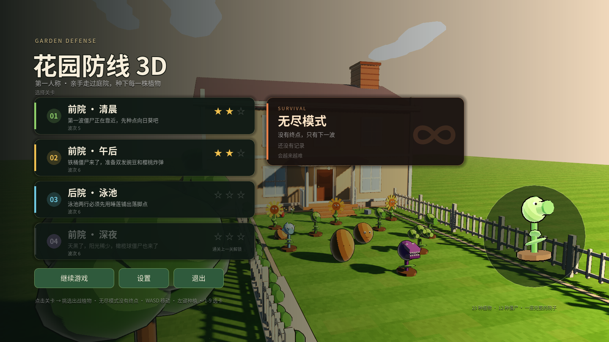
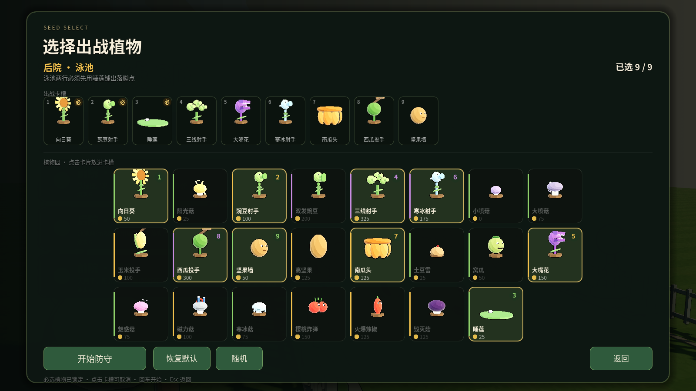

## 运行

用 Godot 4.7 打开这个目录：

```
D:\download_web\Godot_v4.7.2-stable_win64.exe\Godot_v4.7.2-stable_win64.exe --path "D:\PVZ3D\godot"
```

编辑器里按 F5 即可。第一次打开会自动导入字体与音效（约 10 秒）。

项目渲染器是 Forward+ / D3D12，阴影、SSAO、Glow、ACES 都开着。

## 操作

| 按键 | 功能 |
| --- | --- |
| `WASD` / 方向键 | 移动 |
| `Shift` | 冲刺（有体力条，会耗尽） |
| `空格` | 跳 |
| 鼠标 | 转视角 |
| `1`–`9` | 选择种子卡 |
| 左键 | 在准星对准的格子种下 |
| `Q` | 铲掉准星下的植物 |
| `E` | 开门 / 关门（看着门时）· 爬烟囱 / 下烟囱（看着壁炉或烟囱口时）· 否则收准星前方的阳光 |
| `F` / 右键 | 用铲子把僵尸推开（2.6 秒冷却） |
| `Esc` | 暂停 / 设置 |

## 选卡

点任意关卡先进入**选卡界面**：上面是这一关的卡槽，下面是全部 23 种植物的种子库（三排）。
点库里的卡片放进第一个空槽，点卡槽取出（关卡强制要带的 1–3 株显示金色「必」标，取不掉）。
每张卡都是实时 3D 渲染，价格标在卡片上；卡槽满或没带齐必选植物时「开始防守」是灰的。

**三个入口都走这里**：关卡卡片、标题界面的「继续游戏」、结算界面的「下一关」，全部先进
选卡再开局；输了点「重来」则沿用上一把的卡组（和原版一致）。

- 每关的槽位与必选：前院清晨 5 槽（必带向日葵、豌豆）、午后 8 槽（+坚果）、
  后院泳池 9 槽（必带睡莲）、前院深夜 9 槽（必带向日葵、豌豆，推荐整套蘑菇）。
- 选择按关卡记在 `user://garden.cfg`，下次点同一关会接着用上次的卡组；
  「继续游戏」也用你上次的配置。
- `恢复默认` 回到关卡原本的推荐卡组，`随机` 会保留必选并随机补满。

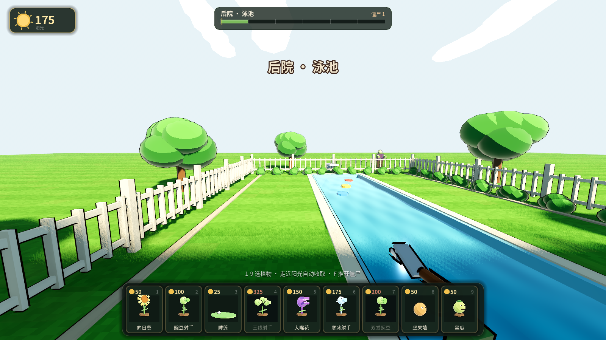

## 内容

**23 种植物**（本次新增 10 种，见下表加粗部分）：

| 类别 | 植物（阳光） |
| --- | --- |
| 产阳光 | 向日葵 50 · 阳光菇 25 |
| 直射 | 豌豆射手 100 · 双发豌豆 200 · 三线射手 325 · 寒冰射手 175 · **小喷菇 0** · **大喷菇 75** |
| 抛射 | **玉米投手 100** · **西瓜投手 300** |
| 防御 | 坚果墙 50 · 高坚果 125 · **南瓜头 125** |
| 控制 / 爆发 | 土豆雷 25 · 窝瓜 50 · 大嘴花 150 · **魅惑菇 75** · **磁力菇 100** · **寒冰菇 75** · 樱桃炸弹 150 · 火爆辣椒 125 · **毁灭菇 125** |
| 水上底座 | 睡莲 25 |

新增植物的具体行为：

- **南瓜头**：种在空地上，然后可以把别的植物种进同一格；僵尸先啃南瓜（4000 血），
  南瓜碎了里面的植物才暴露。铲子先铲里面的植物，再铲南瓜。
- **玉米投手**：抛玉米粒（20 伤害），25% 概率改抛黄油——定身 4.5 秒。
- **西瓜投手**：抛整颗西瓜，命中 80、周围 1.5 米溅射 40。
- **小喷菇**：0 阳光，但射程只有 3.4 米。
- **阳光菇**：先产 15 阳光，种下 36 秒后长大，每次 25。
- **大喷菇**：喷孢子雾，一次打穿正前方 4 米内一整段的所有僵尸（25 伤害 / 1.4 秒）。
- **魅惑菇**：被啃掉时，吃掉它的那只僵尸倒戈，沿草坪往回咬同类，14 秒后倒下。
- **磁力菇**：每 8 秒吸走 4.6 米内铁桶僵尸的水桶或橄榄球的头盔（护甲直接归零）。
- **寒冰菇**：种下 1.3 秒后全场冰冻 5 秒，然后自己消失。
- **毁灭菇**：1.9 秒后 5.2 米范围 3000 伤害，并在原地留一个 60 秒不能种植的坑。

**11 种僵尸**（加伴舞是 12 个模型）：

| 僵尸 | 血 / 护甲 | 特殊行为 |
| --- | --- | --- |
| 普通 | 200 | — |
| 路障 | 470 | 血量过半掉路障 |
| 铁桶 | 450 + 500 护甲 | 水桶算护甲，磁力菇能吸走 |
| 旗帜 | 200 | 带旗、走得快 |
| 报纸 | 190 + 170 护甲 | 报纸碎了暴走（速度 0.40 → 1.15） |
| 橄榄球 | 700 + 800 护甲 | 头盔可被吸走 |
| **撑杆** | 500 | 遇到第一株植物撑杆跳过（0.7 速度，跳完就变成普通僵尸） |
| **铁门** | 280 + 420 护甲 | 铁门挡豌豆；**抛射物（玉米/西瓜）从上方落下，越过铁门** |
| **气球** | 240 | 悬在 2.05 米，飞过所有植物（不吃也不被吃），只能打下来 |
| **舞王** | 380 | 出场自带 4 只伴舞僵尸（左右各两只） |
| **巨人** | 3400 | 不啃，1.15 秒一棒把植物砸没（一次 99999 伤害） |

**护甲是独立一层**：铁桶/铁门/头盔打光之前，本体不掉血；磁力菇把护甲一次性清零。

**4 个关卡**，串成一条从清晨打到深夜的线：

| 关卡 | 场景 | 新增压力 |
| --- | --- | --- |
| 前院 · 清晨 | 教学 | 只有普通 / 路障僵尸 |
| 前院 · 午后 | 午后强光 | 报纸、撑杆、铁门、铁桶 |
| 后院 · 泳池 | 两行水面 | 必须先铺睡莲；气球僵尸直接飘过水面 |
| 前院 · 深夜 | 星空、路灯、暖窗 | 阳光稀少，舞王带伴舞，最后一波是**巨人** |

通关按表现给 1–3 星（不用小推车 +1，用时低于标准 +1），存在 `user://garden.cfg`。

## 无尽模式

标题界面右上角那张橙色的卡就是入口，和关卡一样先进选卡。

- **没有终点**：每一波按预算现生成，波数越高预算越大、间隔越短（24 秒压到 8.5 秒）。
  预算是 `2.5 + 波数 × 1.15 + 波数^1.32 × 0.25`：第 1 波 3.9 点（约 4 只普通），
  第 20 波 38.6 点，第 30 波 59.1 点。实测一个不操作的满配静态阵（15 双发 + 5 西瓜）
  撑到第 22 波，主动补种和丢炸弹还能再往后。
- **出场顺序**：普通/路障 → 第 3 波撑杆 → 第 4 波报纸 → 第 5 波铁桶 → 第 6 波铁门 →
  第 7 波气球 → 第 9 波橄榄球 → 第 11 波舞王 → **第 14 波巨人**。见 `Data.ENDLESS_ROSTER`。
- **HUD 换了读数**：顶部显示「无尽模式 · 第 N 波」，进度条变成"下一波倒计时"。
- **结算**：撑到第几波就记第几波，最佳记录写进 `user://garden.cfg`（`endless_best`）。
- 输掉的条件和普通关一样：僵尸走进屋子且该行小推车已经用掉。

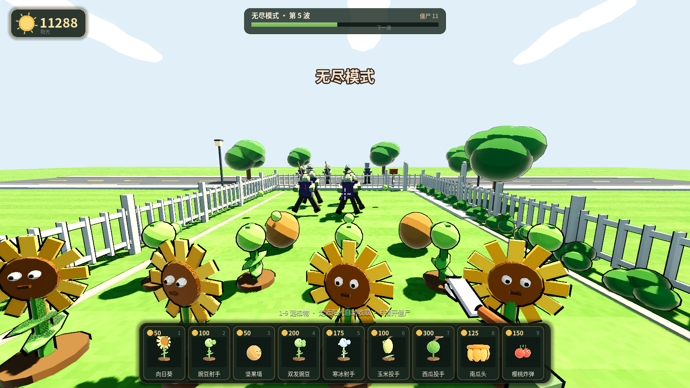

| | |
| --- | --- |
|  | 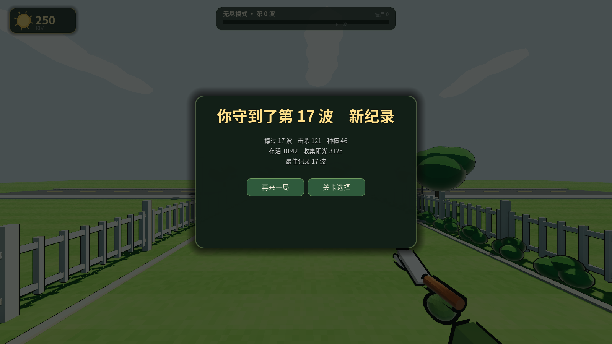 |
| 顶部读数换成「第 N 波」，进度条是下一波倒计时 | 撑到第几波就记第几波 |

## 音乐

背景音乐是 `audio/music/theme.mp3`（用户提供的《屋顶上的苦行山》），运行时循环播放，
按场景换读法：

| 场景 | 音高 | 音量 |
| --- | --- | --- |
| 标题菜单 | 1.00 | -10 dB |
| 白天关卡 | 1.00 | -13 dB |
| 深夜关卡 | 0.91 | -14 dB（同一段旋律压低半个调，变成不安） |
| 无尽模式 | 1.05 | -12 dB |

切换是 1.2 秒交叉淡入，不会硬切；设置里新增「音乐音量」滑杆，与音效音量分开。

## 和页游版的区别

- **一整片连续的院子**：前院、两层住宅、后院泳池、街道与邻居，全部在一个场景里。
- **门是真的门**：走到前门 / 后门 / 后院栅栏门前，准星下面会浮出 `[E] 开门`，门绕铰链
  转开，碰撞体同步撤掉/恢复——关着时走不进去，开着时能直接穿过门框。
- **一条走进后院的完整路线**：客厅 → **后门**（西墙，玻璃门）→ 木露台 → **后院栅栏门**
  （在围栏上开出来的、带门柱和小拱架的真门）→ 两级台阶 → 踏石步道 → 泳池边。以前这条
  路是被一整排栅栏挡死的。
- **烟囱能爬上屋顶**：二楼北墙有一个砖砌壁炉，钻进去是烟道；按 `[E]` 顺着烟道爬上去，
  从烟囱口翻出来就站在屋脊上，能沿两坡走到屋檐。屋顶也给了碰撞体，不是贴图。
- **二楼能住人**：客厅靠西墙有一段 13 级楼梯（墙面扶手），走上去是带天窗光的阁楼卧室——
  床、书桌、衣柜、书架、地毯、落地灯，楼梯口有栏杆。
- **卡通渲染管线**：分级光照 + 法线外扩描边（`shaders/toon.gdshader`），草地、水面、
  种植网格各自有独立着色器。
- **所有美术都是代码生成的**：没有一张贴图、没有一个 glTF。树、栅栏、房子、植物、僵尸
  都是运行时拼的低多边形。
- **种子卡图标是实时的 3D 渲染**：每张卡里一个 `SubViewport`，种下去之前就能看见那株植物
  在慢慢转。
- **音效是合成的**：`tools/gen_audio.py` 用 Python 标准库写了 25 个 wav（种植、射击、
  啃咬、爆炸、僵尸呻吟、脚步、开关门、烟囱、胜负音效、风声），没有版权素材；
  背景音乐是外部 mp3。
- **可无渲染跑关**：`--sim=秒数` 直接把模拟快进完并打印结果，用来验证“这关能不能通”。

## 截图

| | |
| --- | --- |
| 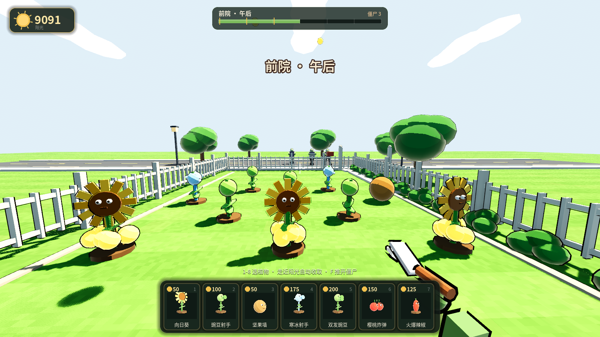 | 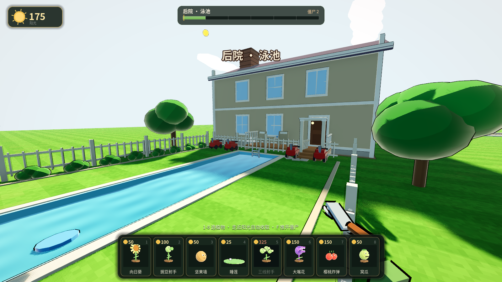 |
| 前院 · 午后，向日葵会转过来看你 | 后院泳池，睡莲上架三线射手 |
| 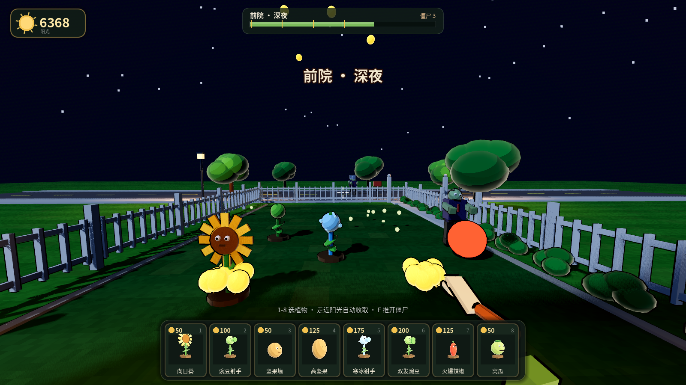 | 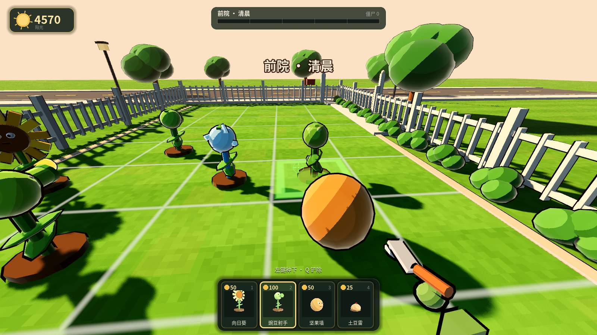 |
| 深夜关：星空、路灯、稀薄的阳光 | 选中卡片后显示网格、高亮格与半透明预览 |

### 新僵尸

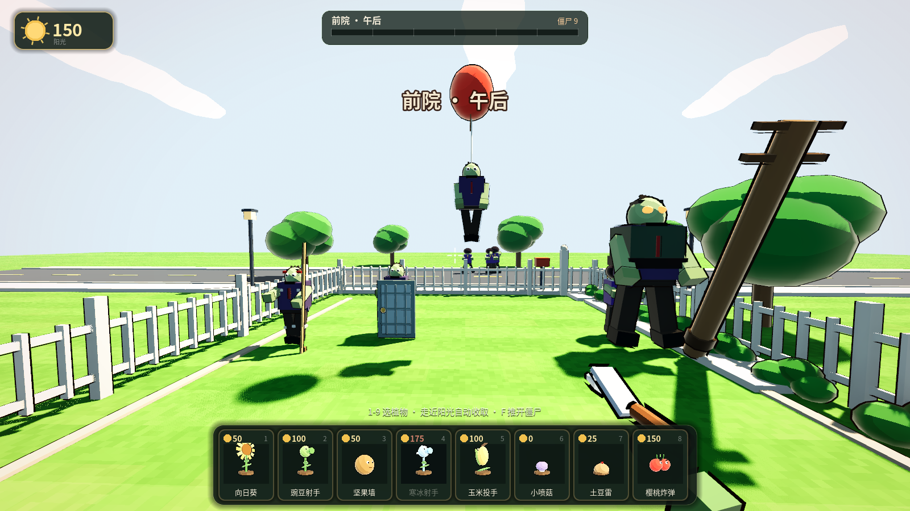
1. 撑杆（举着杆）· 2. 铁门（门挡住半个身子）· 3. 气球（悬在半空）· 4. 舞王 · 5. 巨人（举着电线杆）

### 新增植物

| | |
| --- | --- |
| 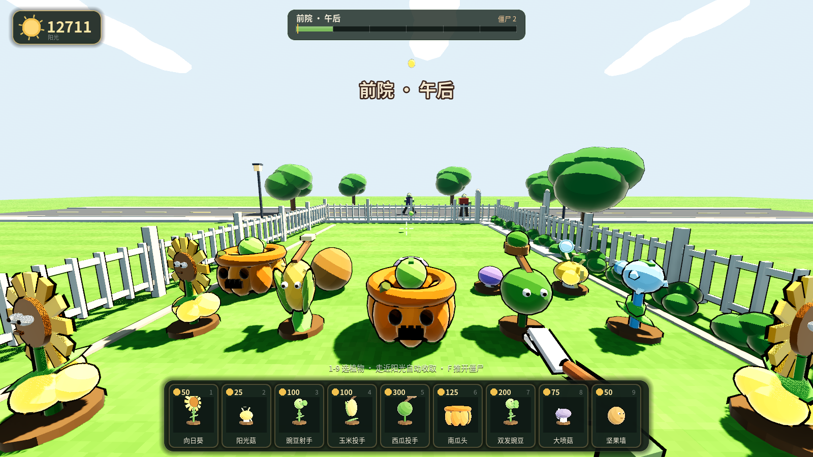 | 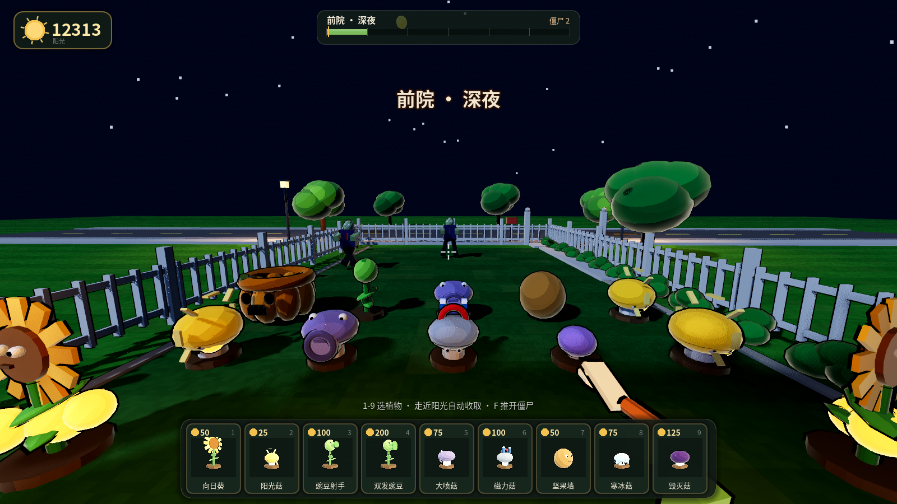 |
| 南瓜头里塞着豌豆射手、玉米/西瓜投手在后排 | 深夜关的蘑菇阵容：阳光菇、大喷菇、磁力菇 |

### 住宅

| | |
| --- | --- |
| 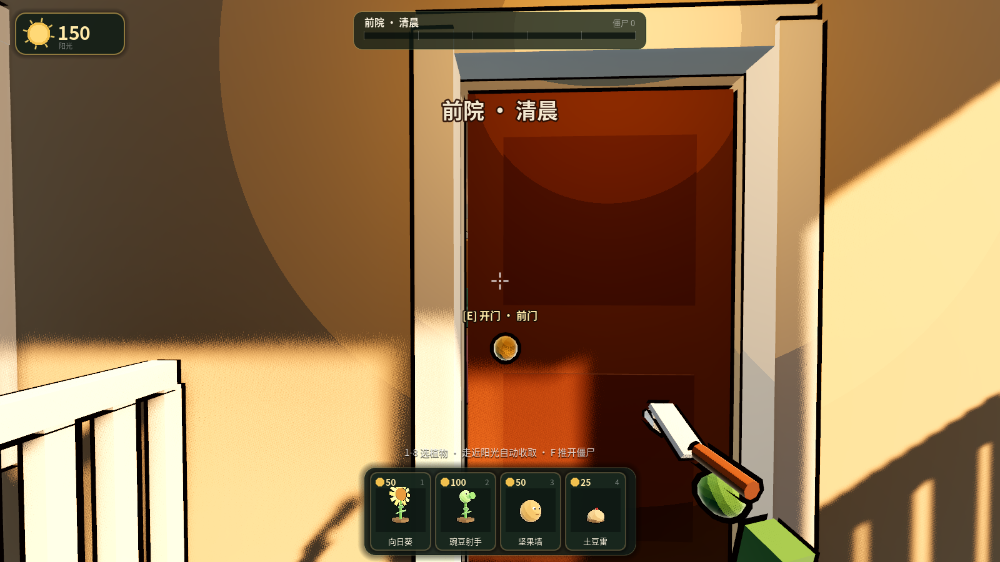 | 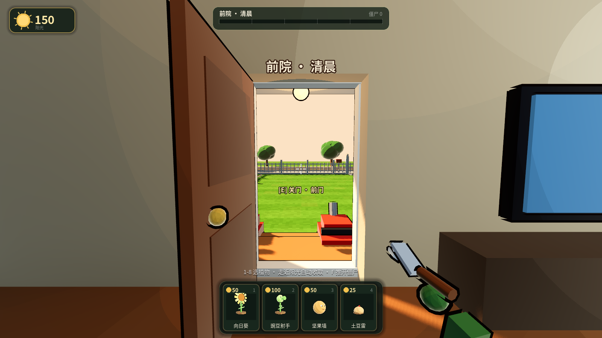 |
| 走到门前，准星下出现 `[E] 开门` | 门向屋内转开，能直接看到草坪 |
| 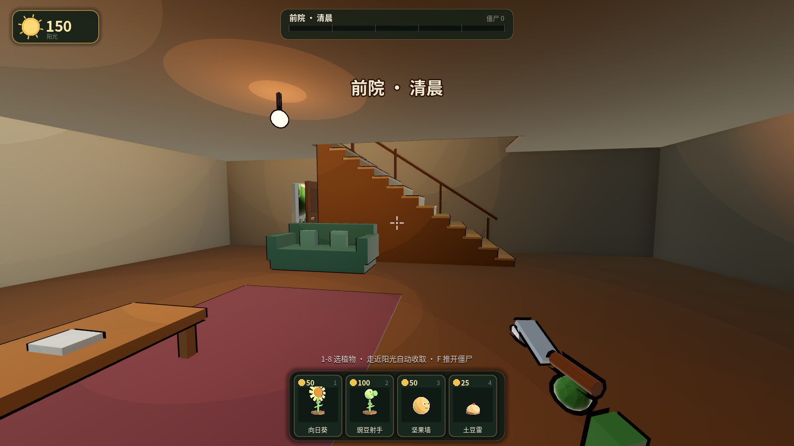 | 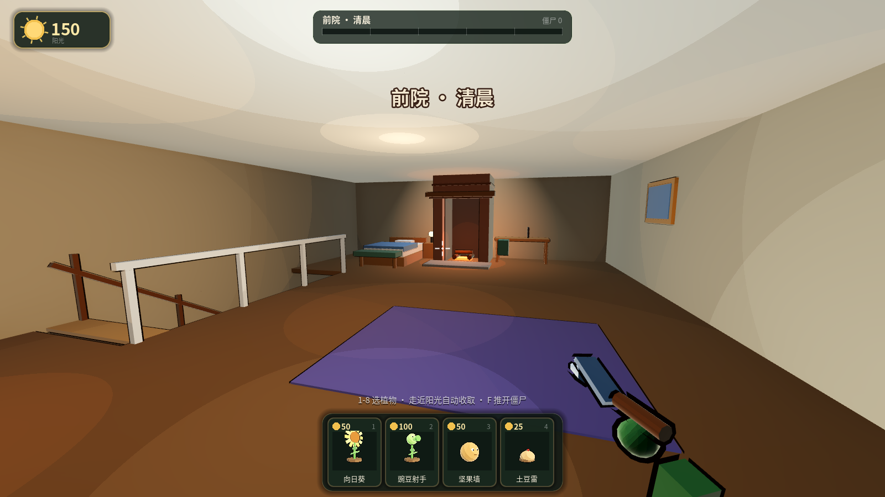 |
| 客厅：沙发、茶几、电视、厨房，西墙是楼梯 | 二楼：床、书桌、壁炉、衣柜、书架，楼梯口有栏杆 |

### 后门 · 露台 · 烟囱

| | |
| --- | --- |
| 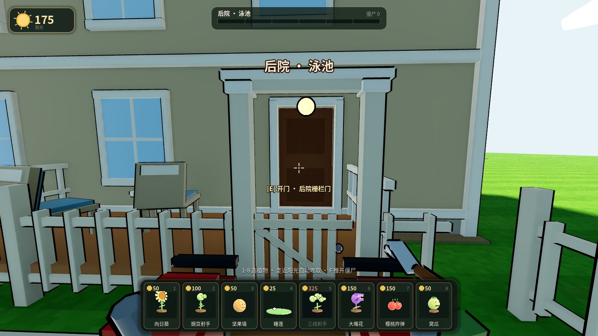 | 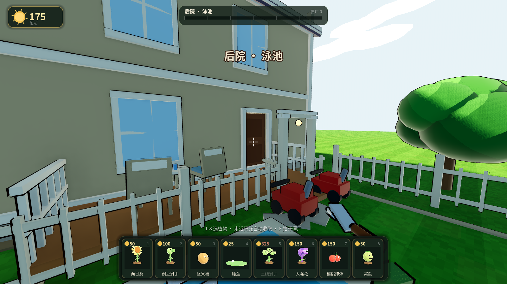 |
| 从后院回望：拱架下的栅栏门、台阶、后门 | 露台：躺椅、边几，西边是穿过围栏的门 |
| 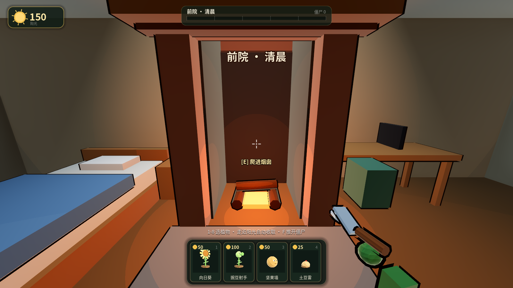 | 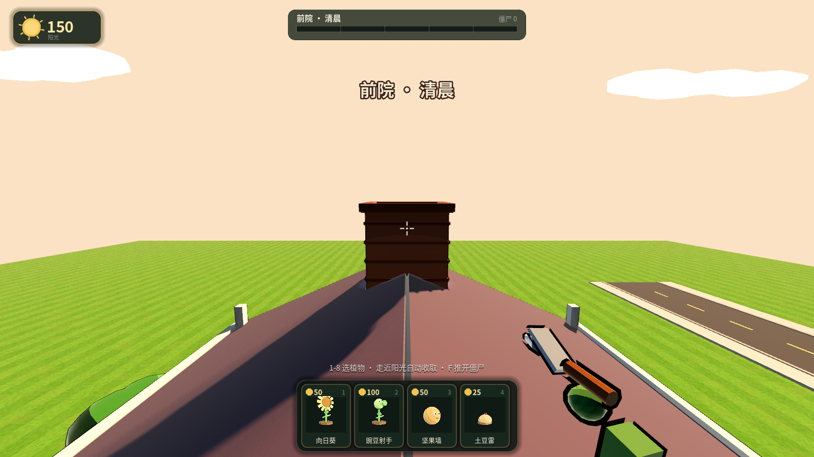 |
| 二楼壁炉，炉膛就是烟道入口 | 顺着烟囱爬上屋脊，两坡都能走 |

## 目录

```
godot/
  project.godot
  scenes/main.tscn          唯一的场景，根节点挂 main.gd
  scripts/
    app.gd                  单例：输入映射、字体主题、存档、音效池
    data.gd                 数值表：庭院尺寸、植物/僵尸属性、4 关波次
    art.gd                  材质与全部程序化模型（植物、僵尸、道具）
    world.gd                整套院子：地形、泳池、住宅、街道、栅栏、天气光照
    player.gd               第一人称控制器（体力冲刺、涉水、脚步、铲子动作）
    match.gd                对局：网格、种植、僵尸、豌豆、阳光、小推车、波次
    hud.gd                  阳光面板、种子栏、波次条、准星、暂停、结算
    ui/menu.gd              标题界面与选关
    ui/seed_chooser.gd      出战选卡：种子库、卡槽、必选锁定、按关卡存档
    ui/plant_icon.gd        SubViewport 实时 3D 图标（可按需换模型 / 暂停渲染）
    units/plant_unit.gd     植物行为与动画
    units/zombie_unit.gd    僵尸行走/啃食/死亡
    units/sun_orb.gd        阳光（下落、漂浮、吸附）
    units/pea_shot.gd       豌豆
    units/lob_shot.gd       抛射物（玉米粒 / 黄油 / 西瓜，走抛物线）
    units/lawn_mower.gd     小推车
    door.gd                 可开关的门 / 栅栏门（铰链旋转 + 碰撞体开关）
  shaders/                  toon / toon_alpha / grass / water / grid / highlight / vignette
  fonts/                    Noto Sans SC（正文 + 粗体）
  audio/                    23 个合成音效
  screenshots/
```

## 实现要点

**确定性 + 可验证。** 所有玩法逻辑都在 `Match.update(dt)` 里，视觉只读状态。
所以可以把 3 分钟的对局在一帧内跑完：

```bash
Godot_v4.7.2-stable_win64_console.exe --headless --path . -- \
  --sim=230 --level=front-1 \
  --plants="0,0,sunflower;1,0,peashooter;1,1,peashooter;2,0,wallnut"
# [sim] { "state": "won", ... } kills=15 mowers_used=0
```

**碰撞不用物理引擎。** 玩家是 `CharacterBody3D`，僵尸是 `AnimatableBody3D`（不参与
自重，只做障碍），植物和小推车是纯视觉节点。台阶用手工斜面碰撞体，比 step-offset
稳。

**相机与瞄准。** 准星射线打到 `y = 0.02` 平面，换算成格坐标；只有选中卡片时才显示
种植网格，避免平时画面太花。

**HUD 全部手绘。** 阳光图标、准星、波次进度、星级都是 `_draw()` 画的，没有九宫格贴图。

**卡通着色器分成两份。** `toon.gdshader` 不写 `ALPHA`，所以材质留在不透明队列、正常写深度；
只有真正要透的东西（种植预览、爆炸闪光、尘土）走 `toon_alpha.gdshader`。这个分离很关键：
一个会写 `ALPHA` 的着色器会被引擎归到透明队列，而透明材质不写深度——结果就是站在屋外
能直接看见屋里的楼梯和沙发。

**烟囱是一条脚本化的攀爬路径。** `WorldBuilder.chimney_path()` 给出从炉膛到屋脊的折线
（进炉膛 → 沿烟道上升 → 从烟囱口翻出 → 落到屋脊），`PlayerController.climb_to()` 按弧长
匀速走完，期间关掉常规物理与手部模型。烟囱是空心的三段砖壁，屋顶在它穿过的地方断开再
补，所以镜头是真的在烟道里上升。

## 调试参数

启动参数放在 `--` 之后：

```
--shot=menu|choose|play|pause|end  截图模式（choose 直接打开选卡界面）
--level=front-1|front-2|back-1|front-3
--cam=x,y,z,yaw,pitch          指定相机（走玩家控制器，所以瞄准有效）
--plants=c,r,kind;c,r,kind     预铺植物，不花钱
--sel=peashooter               预选种子卡（用来拍网格与预览）
--warp=80                      开打前快进 80 秒
--out=D:/path/shot.png
--sim=230                      无渲染跑完整关并打印结果
--loadout=sunflower,lilypad,... 指定出战卡组（跳过选卡界面）
--test=choice                  选卡逻辑自测：必选锁定 / 超选拒绝 / 随机 / 存档回读
--test=zombies                 新僵尸自测：撑杆跳 / 铁门挡豌豆但挡不住西瓜 / 气球飞越 / 舞王召唤 / 巨人一击
--shot=zombies                 摆一排新僵尸拍近景
--test=flow                    验证关卡卡片 / 继续游戏 / 下一关三个入口都会进选卡
--test=plants                  新植物行为自测：护罩、黄油、溅射、破甲、策反、冰冻、核爆
--doors=open                   开局把所有门打开
--walk=stair|door|doorclosed   物理行走测试：上楼 / 穿门 / 验证关门挡人
--walk=backyard                从客厅走到后院草坪（后门 → 露台 → 栅栏门 → 台阶）
--walk=gateclosed              验证栅栏门关着时挡人
--walk=chimney                 从二楼壁炉爬到屋脊，打印落点与是否站稳
```

例：

```bash
Godot_v4.7.2-stable_win64_console.exe --path . --resolution 1600x900 -- \
  --shot=play --level=front-2 --cam="-6.8,2.0,0.1,-92,-7" \
  --plants="2,0,sunflower;3,1,peashooter;4,2,repeater" --warp=80 \
  --out=shot.png
```

## 打包

`export_presets.cfg` 里配好了一个 Windows 桌面预设：x86_64、**单文件 exe**（pck 内嵌）、
带图标与产品名。

```
Godot_v4.7.2-stable_win64_console.exe --headless --path "D:/PVZ3D/godot" \
  --export-release "Windows Desktop" "D:/PVZ3D/build/花园防线3D.exe"
```

- 已经导出了一份：`D:/PVZ3D/build/花园防线3D.exe`（约 124 MB，双击即玩，不需要装 Godot）。
- 导出模板需要同版本（`%APPDATA%/Godot/export_templates/4.7.2.stable/`，1.28 GB），
  已经装好；换机器要重新装。
- 产物在项目外的 `build/`，已进 `.gitignore`；`screenshots/`、`tools/`、`*.md` 在导出排除清单。
- **验证**：把这份 exe 拷到别的目录跑 `--headless -- --sim=25`，能正常开局、加载存档目录、
  跑完 25 秒模拟并打印 `[sim] { "state": "playing", ... }`。
  （在 `D:/PVZ3D/build` 里直接执行会被本机的命令沙箱挡住，报 "Couldn't load project data"，
  同样的文件拷到别处就正常——这是沙箱限制，不是包的问题，资源管理器里双击不受影响。）

## 已知取舍

- 阁楼（屋顶下那层）不可进入，二楼是最高可走层；上屋顶只能走烟囱。
- 门只有前门、后门、后院栅栏门；室内没有可开关的房门。
- 后院栅栏门现在默认是**关**的（看得出是扇门），按 `[E]` 打开。
- **气球僵尸**简化了：它悬空飞过植物，但豌豆仍然能打中（不做高度判定）。原版要三叶草/仙人掌，
  本作没有那两种植物，做成"打不下来就等着挨"会让某些卡组直接无解。
- **巨人**没有小鬼僵尸（原版血量过半会扔小鬼），本作直接按血量算。
- 种子库一开始就开放全部 23 种，没有解锁进度；关卡之间只有「必选」和槽位数不同。
- 蘑菇**昼夜都能用**（原版白天会睡觉、要咖啡豆唤醒）。本作没有咖啡豆，也不想让白天的
  蘑菇位变成废卡，所以统一取消休眠。
- 南瓜头只能种在陆地上，不能罩在睡莲上；水面那两行仍然要先铺睡莲。
- 卡槽数量只做到 9（对应键盘 1–9），再多就要重排底部 HUD。
- 后院两条草坪上的小推车正好停在台阶两侧（它们按行摆，不参与碰撞），走的时候会从
  两辆车中间穿过去。
- 僵尸沿直线推进，不会绕路、翻越或从水里爬上岸。
- 水面是顶点波动 + 菲涅尔近似，没有真实反射/折射。
- 只有一套存档位（星级 / 最佳记录 / 卡组 / 无尽最高波数 / 设置），没有多周目。
- 没有中途存档：一关打到一半退出，本次进度不保留。
- 界面是固定 1600×900 的逻辑分辨率（`canvas_items` 拉伸），超宽屏会留边。
